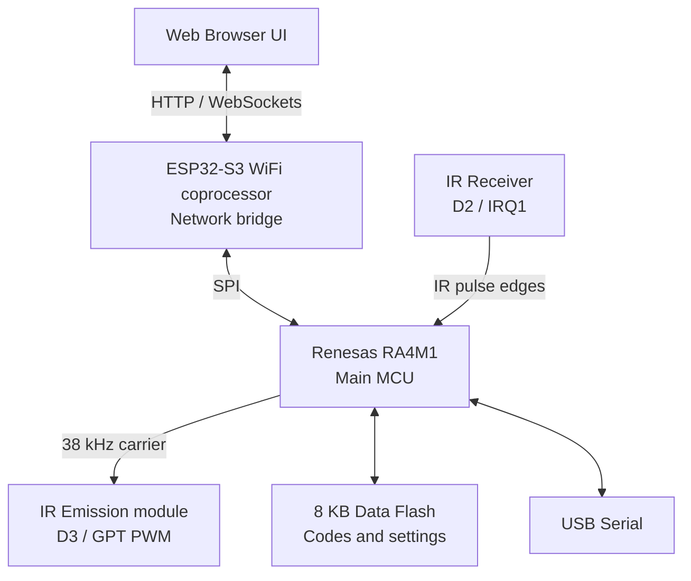
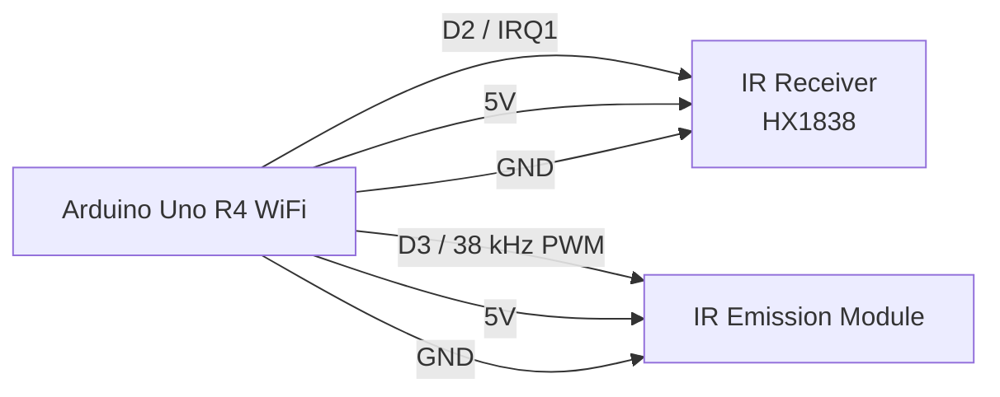

# Arduino UNO R4 WiFi IR Learning Remote

IR Learner is an open-source firmware prototype for capturing, organizing, and replaying infrared remote commands with an **Arduino UNO R4 WiFi** (Renesas RA4M1 + ESP32-S3). It provides a browser-based dashboard, local command storage, protocol-oriented decoding, and raw timing replay. Performance has not been evaluated in a controlled study; see [Limitations](#limitations).

---

## Architecture Overview



### Key Modular Components
* **`WiFiManager`**: Dynamically transitions between Station (STA) mode connecting to home routers and local Access Point (AP) Configuration Portal mode if setup fails or credentials are unset. Integrated mDNS responder (`irremote.local`).
* **`IRReceiver`**: Captures edge timings on D2 (IRQ1) into a 400-entry buffer. It attempts NEC, Samsung, Sony, Panasonic, LG, JVC, and heuristic RC5 decoding; unmatched captures are retained as raw timings. RC6 receive decoding is not implemented. The displayed quality value is a fixed heuristic, not a measured confidence score.
* **`IRSender`**: Uses the RA4M1 PWM abstraction on D3 for a nominal 38 kHz carrier at approximately 33% duty cycle; the Sony send routine uses 40 kHz. Raw timing arrays can also be replayed.
* **`Storage`**: Uses an 8 KB EEPROM-compatible data-flash region for settings and command records, with an in-memory index capped at 100 entries. Raw timings use a compact per-duration scaled/escape encoding; storage capacity depends on record content.
* **`Web` / `API`**: Serves the embedded single-page application and JSON endpoints over HTTP, with WebSocket status and log events.

---

## Hardware Assembly & Pinout

### Receiver (HX1838)
* **S / Signal** -> **D2** (External Interrupt IRQ1)
* **VCC / Power** -> **5V**
* **GND** -> **GND**

### Emitter (IR Emission module)
The project uses the existing three-pin IR Emission module. It is driven by the Arduino Uno R4 WiFi hardware PWM output at approximately 38 kHz.

* **S / Signal** -> **D3**
* **VCC / Power** -> **5V**
* **GND** -> **GND**

Point the IR LED towards the appliance's IR window. Practical range depends on emitter hardware, alignment, ambient light, and the appliance receiver; no controlled range measurement is provided.



---

## Installation, Configuration, Compilation & Upload

### Prerequisites
1. Install **Arduino IDE 2.x** or **Arduino CLI**.
2. Install the **Arduino UNO R4 Boards** platform (CLI core identifier: `arduino:renesas_uno`). The sketch uses the platform's Wi-Fi and PWM facilities; mDNS is implemented in the repository, so no separate mDNS library is required.
3. From the repository root, create the local configuration header from the tracked example:
   ```powershell
   Copy-Item src/config.h.example src/config.h
   ```
   `src/config.h` is intentionally ignored by Git because it may contain Wi-Fi credentials. Leave the default SSID empty to start in access-point setup mode, or enter your own network credentials. Do not commit credentials.

### Compile with Arduino CLI
From the repository root, install the board platform once and compile:
```powershell
arduino-cli core install arduino:renesas_uno
arduino-cli compile --fqbn arduino:renesas_uno:unor4wifi .
```

To upload, first list connected boards with `arduino-cli board list`, then use the reported port:
```powershell
arduino-cli upload -p COM_PORT --fqbn arduino:renesas_uno:unor4wifi .
```
Replace `COM_PORT` with the actual port (for example, `COM5`). In Arduino IDE, open `IR_Learner.ino`, select **Arduino UNO R4 WiFi** and the device port, then use **Verify** and **Upload**.

---

## First-Time WiFi Setup (Configuration AP)

1. On first boot or after a factory reset, the device copies the defaults in your local `src/config.h` to persistent EEPROM/Data Flash.
2. If `DEFAULT_WIFI_SSID` is set, the device attempts to join that network. Saved Settings-page values remain in persistent storage and are used on subsequent boots.
3. If the SSID is empty, missing, or cannot connect within 15 seconds, it starts a local Wi-Fi Access Point named **`IR_Learner_XXXX`** (where `XXXX` are the last 4 characters of its MAC address).
4. Connect your computer or phone to this network (no password required), then open **`http://192.168.4.1`**.
5. Go to the **Settings** tab. Enter your router SSID and password, configure an optional mDNS hostname (for example, `irremote`), and press **Save & Apply**.
6. The controller persists these settings to EEPROM/Data Flash, shuts down the AP, and reboots. They override `config.h` defaults until the next factory reset.
7. Once connected to your network, access the interface at **`http://irremote.local`** or the DHCP IP address shown in the Serial Monitor at 115200 baud.

---

## REST API Documentation

All requests and responses use the `application/json` content-type.

### 1. Device Diagnostics
* **Endpoint:** `GET /api/status`
* **Response:**
  ```json
  {
    "rssi": -55,
    "ip": "192.168.1.104",
    "freeRam": 18450,
    "flashUsage": 135400,
    "uptime": 240,
    "state": "IDLE",
    "wifiSSID": "MyHomeRouter",
    "wifiAP": false
  }
  ```

### 2. Get Stored Commands List
* **Endpoint:** `GET /api/codes`
* **Response:**
  ```json
  [
    {
      "id": 1,
      "name": "TV Power",
      "protocol": 1,
      "address": 16128,
      "command": 61234,
      "bits": 32,
      "frequency": 38000,
      "rawLength": 0
    }
  ]
  ```

### 3. Start IR Signal Learning
* **Endpoint:** `POST /api/learn/start`
* **Response:** `{"status":"ok","msg":"Learning started"}`

### 4. Stop IR Signal Learning
* **Endpoint:** `POST /api/learn/stop`
* **Response:** `{"status":"ok","msg":"Learning stopped"}`

### 5. Check Capture Status
* **Endpoint:** `GET /api/learn/status`
* **Response:**
  ```json
  {
    "state": "FINISHED",
    "decoded": true,
    "protocol": 1,
    "address": 16128,
    "command": 61234,
    "bits": 32,
    "pulses": 67,
    "quality": 95,
    "raw": []
  }
  ```

### 6. Transmit Signal
* **Endpoint:** `POST /api/send`
* **Payload (Send by ID):** `{"id": 1}`
* **Payload (Direct raw emit):**
  ```json
  {
    "protocol": 0,
    "address": 0,
    "command": 0,
    "bits": 0,
    "frequency": 38000,
    "rawLength": 4,
    "raw": [9000, 4500, 560, 560]
  }
  ```
* **Response:** `{"status":"ok","msg":"Signal transmitted successfully"}`

### 7. Delete Command
* **Endpoint:** `POST /api/delete`
* **Payload:** `{"id": 1}`
* **Response:** `{"status":"ok","msg":"Command deleted successfully"}`

### 8. Rename Command
* **Endpoint:** `POST /api/rename`
* **Payload:** `{"id": 1, "name": "Living Room TV"}`
* **Response:** `{"status":"ok","msg":"Command renamed successfully"}`

### 9. Export Database Backup
* **Endpoint:** `POST /api/export`
* **Response:** `{"status":"ok","database":[...Array of stored codes...]}`

### 10. Import Database Backup
* **Endpoint:** `POST /api/import`
* **Payload:** JSON Array containing code objects.
* **Response:** `{"status":"ok","msg":"Imported 5 commands successfully","count":5}`

---

## Troubleshooting & FAQ

### Device fails to boot or loops after configuration
Verify that you are using a stable 5V power supply. Toggling the WiFi stack and emitting signals simultaneously can cause power dips on standard USB ports. Use an external 9V/12V DC barrel jack adaptor if needed.

### Port is not visible or mDNS fails to resolve
mDNS resolution requires Bonjour support (native on Windows 10/11, macOS, and iOS). If you are on an older OS, make sure you can reach the device via its IP address printed in the Serial Monitor. Ensure that client isolation is disabled in your router settings.

---

## Limitations

* **Fixed hardware pins:** The IR receiver uses D2 and the IR Emission module uses D3. Changing either requires a code change and compatible interrupt/PWM support.
* **IR range and alignment:** Range depends on LED alignment, emitter drive, appliance receiver sensitivity, ambient light, and supply voltage; it has not been characterized under controlled conditions.
* **Receiver carrier band:** The HX1838 receiver is designed for signals around 38 kHz. Remotes using substantially different carrier frequencies may have reduced learning reliability.
* **Raw capture and storage:** A learned raw signal is limited to 400 timing entries. The 8 KB EEPROM/Data Flash is shared by Wi-Fi settings and saved codes, so the number of raw commands that fit depends on their length.
* **Local-network access:** The web interface has no authentication. Use it only on a trusted local network; do not expose it directly to the internet.

## License

The source code is distributed under the [MIT License](LICENSE).

---

## Future Improvements
* Add support for 40 kHz (Sony native) and 36 kHz (RC5 native) subcarrier filters on physical receiver shields.
* Implement custom IR protocol macros (combining multiple TV and Receiver signals into one key click).
* Support dynamic WebSocket terminal inputs to run debugging shells at runtime.
